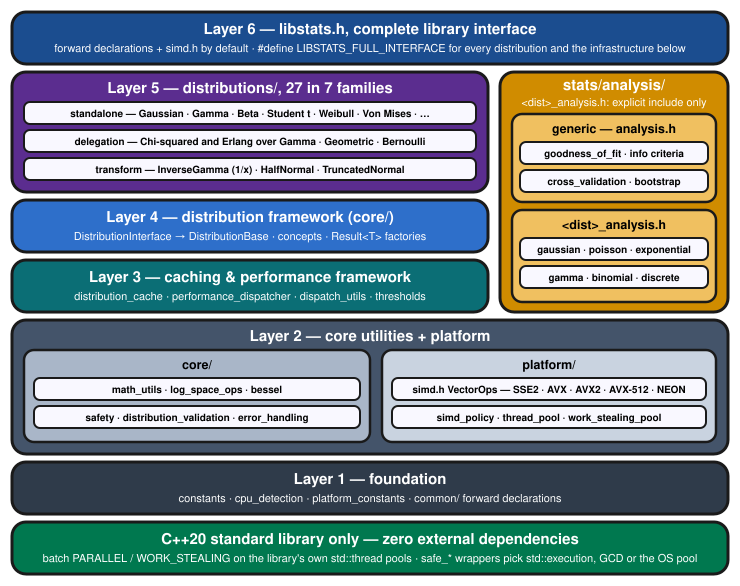

# libstats - Modern C++20 Statistical Distributions Library

---

### v2.5.0 released

**v2.5.0 is the current release.** v1.5.3 was the final v1.x release.
See [MIGRATION_GUIDE.md](MIGRATION_GUIDE.md) for breaking changes and upgrade instructions.

v2.4.0 grows the library 19 → 27 distributions — Logistic, Gumbel,
Bernoulli, Erlang, Fisher F, Inverse-Gamma, Half-Normal, and Truncated
Normal — all born compliant with the ±inf-limit, finite-quantile,
batch-NaN-propagation, and no-aliasing contracts. Every parallel
dispatch threshold table is now measurement-backed: profiling exposed
that 18 sliced batch sites never actually forked below ~8.4M elements,
and every SIMD tier was re-measured on the repaired code (AVX-512,
AVX2, NEON native; AVX via a capped build). The API is additive over
v2.3.1 — upgrading is a drop-in swap.

v2.4.1 is a correctness patch over v2.4.0 — no API change. It fixes
NegativeBinomial/Geometric counts past INT_MAX (pmf, logpmf, cdf and
`sample()`), and makes `parallelReduce`/`parallelStatOperation` wait for
every chunk before rethrowing, as `parallelFor` already did.

v2.5.0 is a correctness and accuracy release — no source API change. Every
distribution has a complement-native `getSurvival`; an mpmath sweep that
now covers survival drove fixes to quantiles, deep tails and
large-parameter densities; batch calls evaluate on one parameter snapshot; and parameter
validation is one validator per distribution. Some results change: see the
v2.4 → v2.5 section of [MIGRATION_GUIDE.md](MIGRATION_GUIDE.md) and
[Contracts](#contracts) below. The dispatch-threshold tables were re-derived
from fresh captures on all three fleet machines and verified by a loaded A/B.
clang-cl is supported on Windows, and CI adds ThreadSanitizer and
FMA-contraction legs.

---

[](https://github.com/OldCrow/libstats/releases/tag/v2.5.0)
[](https://github.com/OldCrow/libstats/actions/workflows/ci.yml)
[](https://codecov.io/gh/OldCrow/libstats)
[](https://isocpp.org/std/the-standard)
[](https://cmake.org/)
[](LICENSE)
[](#-safety--numerical-stability)
[](#-performance-features)

A modern C++20 statistical distributions library demonstrating how to build statistical software correctly — with genuine SIMD vectorization, parallel dispatch, thread safety, and one deliberate dependency: [corvus](https://github.com/OldCrow/corvus) for the special functions.

**📖 Complete Documentation:** For detailed information about building, architecture, parallel processing, and platform support, see the [comprehensive guides](#documentation) below.

## Features

### 🎯 **Complete Statistical Interface**
- **PDF/CDF/Quantiles**: Full probability density, cumulative distribution, and quantile functions
- **Statistical Moments**: Mean, variance, skewness, kurtosis with thread-safe access
- **Random Sampling**: Takes a caller's `std::mt19937`; most samplers use std:: distributions, some their own transforms (Gaussian: Box–Muller)
- **Parameter Estimation**: Maximum Likelihood Estimation (MLE) with comprehensive diagnostics
- **Statistical Validation**: KS and AD Goodness-of-Fit, model selection

### 📊 **Available Distributions** (27 across 7 families)

**Symmetric, unbounded continuous**
- Gaussian (Normal) N(μ, σ²) · Student's t t(ν) · Logistic L(μ, s)
- Laplace Laplace(μ, b) · Cauchy Cauchy(x₀, γ)

**Asymmetric, unbounded continuous**
- Gumbel G(μ, β)

**Positive-support continuous** (x ≥ 0)
- Exponential Exp(λ) · Gamma Γ(α, β) · Chi-squared χ²(ν)
- Log-Normal LogN(μ, σ) · Weibull W(k, λ) · Rayleigh R(σ)
- Erlang Erl(k, λ) · Inverse-Gamma IG(α, β) · Fisher F F(d₁, d₂)
- Half-Normal HN(σ)

**Heavy-tailed / power-law** (x ≥ x_m)
- Pareto Pareto(x_m, α)

**Bounded continuous**
- Uniform U(a, b) · Beta Beta(α, β) · Truncated Normal TN(μ, σ, a, b)

**Circular / directional**
- Von Mises VM(μ, κ)

**Discrete**
- Poisson P(λ) · Discrete (integer range)
- Binomial B(n, p) · Negative Binomial NB(r, p) · Geometric Geo(p)
- Bernoulli Bern(p)

### ⚡ **Modern C++20 Design**
- **Thread-Safe**: Concurrent read access with safe cache management
- **Zero Dependencies**: Only standard library required
- **SIMD Optimized**: Vectorized operations for bulk calculations
- **Memory Safe**: RAII principles and smart pointer usage
- **Exception Safe**: Robust error handling throughout
- **C++20 Concepts**: Type-safe mathematical function interfaces
- **Parallel Processing**: Traditional and work-stealing thread pools

### 🛡️ **Safety & Numerical Stability**
- **Memory Safety**: Comprehensive bounds checking and overflow protection
- **Numerical Stability**: Safe mathematical operations and edge case handling
- **Error Recovery**: Multiple strategies for handling numerical failures
- **Convergence Detection**: Advanced monitoring for iterative algorithms
- **Diagnostics**: Automated numerical health assessment

### 🧪 **Statistical Validation**
- **Goodness-of-Fit Tests**: Kolmogorov-Smirnov, Anderson-Darling (✅ implemented)
- **Model Selection**: AIC/BIC information criteria (✅ implemented)
- **Residual Analysis**: Standardized residuals and diagnostics (✅ implemented)
- **Cross-Validation**: K-fold validation framework (✅ implemented)

### 🚀 **Performance Features**
- **SIMD Operations**: Vectorized statistical computations with cross-platform detection
- **Parallel Processing**: Both traditional and work-stealing thread pools
- **C++20 Parallel Algorithms**: Safe wrappers for `std::execution` policies
- **Cache Optimization**: Thread-safe caching under a reader-writer lock; batch calls evaluate on one parameter snapshot

**📖 Cross-Platform SIMD Support**: Automatic detection and optimization for SSE2/AVX/AVX2/AVX-512/NEON instruction sets with runtime safety verification. Validated on Intel Kaby Lake (AVX2+FMA natively; the AVX tier via a `LIBSTATS_MAX_SIMD_TIER=AVX` capped build), Apple Silicon (M1/NEON), AMD Ryzen Zen 4 (AVX-512), and Linux CI.

## Quick Start

### Quick Build

```bash
git clone https://github.com/OldCrow/libstats.git
cd libstats
mkdir build && cd build
cmake ..                    # Auto-detects optimal configuration
make -j$(nproc)            # Parallel build with auto-detected core count
ctest --output-on-failure  # Run tests
```

**📖 For complete build information**, including cross-platform support, SIMD optimization, and advanced configuration options, see [docs/BUILD_SYSTEM_GUIDE.md](docs/BUILD_SYSTEM_GUIDE.md).

### Basic Usage

```cpp
#define LIBSTATS_FULL_INTERFACE  // without it, libstats.h is forward declarations only
#include "libstats.h"
#include <iostream>
#include <numeric>
#include <span>
#include <vector>

int main() {
    // Initialize performance systems (recommended)
    stats::initialize_performance_systems();

    // Create distributions with safe factory methods
    // stats:: is the primary namespace; libstats:: is an alias kept for compatibility.
    auto gaussian_result = stats::GaussianDistribution::create(0.0, 1.0);
    if (gaussian_result.isOk()) {
        auto& gaussian = *gaussian_result;  // operator* returns T&

        // Single-value operations
        std::cout << "PDF at 1.0: " << gaussian.getProbability(1.0) << std::endl;
        std::cout << "CDF at 1.0: " << gaussian.getCumulativeProbability(1.0) << std::endl;

        // High-performance batch operations (auto-optimized)
        std::vector<double> values(10000);
        std::vector<double> results(10000);
        std::iota(values.begin(), values.end(), -5.0);

        gaussian.getProbability(std::span<const double>(values),
                               std::span<double>(results));

        std::cout << "Processed " << values.size() << " values with auto-optimization" << std::endl;
    }
    return 0;
}
```

**📖 For comprehensive parallel processing and batch operation guides**, see [docs/PARALLEL_BATCH_PROCESSING_GUIDE.md](docs/PARALLEL_BATCH_PROCESSING_GUIDE.md).

## Project Structure

```
libstats/
├── include/libstats/  # Modular header architecture (mirrors the installed layout)
│   ├── libstats.h        # Complete library (single include)
│   ├── core/             # Core mathematical and statistical components
│   ├── distributions/    # Statistical distributions (Gaussian, Exponential, etc.)
│   ├── stats/analysis/   # Statistical tests and estimators (stats::analysis::)
│   └── platform/         # SIMD, threading, and platform optimizations
├── src/              # Implementation files
├── tests/            # Comprehensive unit and integration tests
├── examples/         # Usage demonstrations
├── tools/            # Performance analysis and optimization utilities
├── docs/             # Complete documentation guides
└── scripts/          # Build and development scripts
```

Headers depend strictly downward through six layers; `stats/analysis/` sits beside the stack:



**📖 For detailed header organization and dependency management**, see [docs/HEADER_ARCHITECTURE_GUIDE.md](docs/HEADER_ARCHITECTURE_GUIDE.md). Process-level diagrams: [class hierarchy](docs/UML/class-hierarchy.svg), [batch dispatch pipeline](docs/UML/dispatch-pipeline.svg), [thread-safety cache](docs/UML/thread-safety-cache.svg), [Result&lt;T&gt; factory flow](docs/UML/result-factory-flow.svg).

## Key Features Summary

### 🎯 **Statistical Completeness**
- PDF, CDF, quantiles, parameter estimation, and validation
- 27 distributions across 7 families (symmetric, asymmetric unbounded, positive-support, power-law, bounded, circular, discrete)
- Beyond `std::` distributions with full statistical interfaces

### ⚡ **High Performance**
- Automatic SIMD optimization (SSE2, AVX, AVX2, AVX-512, NEON)
- Intelligent parallel processing with auto-dispatch
- Thread-safe batch operations with work-stealing pools
- Smart caching and adaptive algorithm selection

### 🛡️ **Enterprise Safety**
- Memory-safe operations with comprehensive bounds checking
- Exception-safe error handling with safe factory methods
- Thread-safe concurrent access with reader-writer locks
- Numerical stability with log-space arithmetic

### 🔧 **Modern C++20 Design**
- One dependency: [corvus](https://github.com/OldCrow/corvus) (special and elementary functions, MIT) with Google Highway (Apache-2.0) beneath it — found or fetched at configure time, pinned to a release
- C++20 concepts, `std::span`, and execution policies
- Cross-platform: Windows, macOS, Linux with automatic optimization

## Comparison with std:: Library

| Feature | std:: distributions | libstats |
|---------|-------------------|----------|
| **Random Sampling** | ✅ Excellent | ✅ Mostly via std:: distributions |
| **PDF Evaluation** | ❌ Not available | ✅ Complete implementation |
| **CDF Evaluation** | ❌ Not available | ✅ Complete implementation |
| **Quantile Functions** | ❌ Not available | ✅ Complete implementation |
| **Parameter Fitting** | ❌ Not available | ✅ MLE with diagnostics |
| **Statistical Tests** | ❌ Not available | ✅ Comprehensive validation |
| **Thread Safety** | ⚠️ Limited | ✅ Full concurrent access |

## Contracts

Behaviour the API guarantees and code can rely on. Details in
[docs/PARALLEL_BATCH_PROCESSING_GUIDE.md](docs/PARALLEL_BATCH_PROCESSING_GUIDE.md)
and the per-distribution headers.

- **Survival and hazard.** All 27 distributions form `getSurvival(x)`
  directly, not as `1 − F(x)`, so the upper tail keeps its precision; the
  `1 − F` default remains only for user-derived classes. `getHazard(x)`
  reads f and S from one parameter state; for discrete distributions it
  evaluates both at `floor(x)`.
- **Discrete quantiles.** For p ≤ ½, the smallest k with F(k) ≥ p; for
  p > ½, the smallest k with S(k) ≤ 1 − p. Q(0) is the support's lower end
  and Q(1) its upper end (+∞ for Poisson, NegativeBinomial and Geometric,
  except Geometric(1), whose Q(1) is 0; n for Binomial; b for Discrete).
  Past 2^53 the result is the smallest double count that meets the rule
  (+∞ if none): Geometric(1e-20).Q(½) = 6.93e19.
- **Discrete pmf vs CDF at non-integers.** The pmf rounds x to the nearest
  integer (halves away from zero); the CDF and survival floor it. So
  pmf(x) ≠ F(x) − F(x − 1) at non-integer x.
- **Parameter ranges.** Constructors, setters, `trySet*`, `create` and
  `fit` share one validator per distribution. Rejected: a subnormal scale
  for Cauchy, Laplace, Logistic and Gumbel; Student-t ν < DBL_MIN; Gaussian
  and LogNormal σ outside [√DBL_MIN, 1e10].
- **Batch calls.** Input and output spans must have equal sizes and must not
  overlap. A batch evaluates on one parameter snapshot under every strategy
  except SCALAR (forced, or AUTO's choice for small counts), which locks per
  element and can mix states under a concurrent setter. NaN propagates
  through every scalar and batch method.
- **Exceptions in parallel batches.** `PARALLEL` waits for every chunk and
  rethrows the first exception; `WORK_STEALING` swallows chunk exceptions
  silently.

## Examples and Tools

### 📚 **Examples** (`examples/` directory)
- `quick_start_tutorial.cpp` - 5-minute introduction to the core API
- `basic_usage.cpp` - End-to-end usage of creation, evaluation, sampling, fitting, and batch APIs
- `distribution_families_demo.cpp` - All 27 distributions organized by family: what each models, when to use it, and how to choose within a family
- `statistical_validation_demo.cpp` - Goodness-of-fit tests, cross-validation, bootstrap CIs, and model selection
- `parallel_execution_demo.cpp` - Batch-processing and dispatch workflow
- `performance_dispatch_demo.cpp` - `PerformanceHint` and strategy selection
- `logpdf_and_likelihood_demo.cpp` - Log-densities and log-likelihoods
- `error_handling_demo.cpp` - `Result<T>` factories, `trySet*` and exceptions

### 🔧 **Analysis Tools** (`tools/` directory)
- `system_inspector` - CPU capabilities and system information
- `simd_verification` - SIMD correctness and speedup verification
- `strategy_profile` - Canonical forced-strategy profiler for dispatcher threshold tuning
- `parallel_batch_fitting_benchmark` - Parallel batch fitting performance analysis
- `accuracy_sweep` + `accuracy_vs_mpmath.py` - Accuracy sweep (pdf, logpdf, cdf, quantile, survival) against mpmath; see [docs/ACCURACY_CHARACTERIZATION.md](docs/ACCURACY_CHARACTERIZATION.md)
- `tools/bench/` - Release-to-release per-element cost bench and comparer


## Testing

```bash
# Correctness suite — parallel-safe, always reliable
ctest -LE "timing|benchmark"             # 132 tests; make run_tests_correctness runs 122 (no stress/dynamic)

# Timing/speedup tests — run serially for accurate results
make run_tests_timing                    # or: ctest -j1 -L timing

# Everything (148 tests, including dynamic linking tests)
make run_all_tests

# SIMD correctness and speedup measurement
./build/tools/simd_verification

# Run a specific test
ctest -R test_gaussian_basic
```

Tests are labelled: **no label** = correctness (parallel-safe); **timing** = speedup assertions (run serially); **benchmark** = performance tools (not in standard suite). The `*_enhanced` GTest tests use the system GTest when present and otherwise fetch googletest automatically (FetchContent), so they always build.

### System Requirements
- **C++20 compatible compiler**: GCC 13+, Clang 17+, AppleClang 15+, MSVC 19.38+
- **CMake**: 3.25 or later
- **Platform**: Windows, macOS 13+, Linux (automatic detection and optimization)

#### Common Build Configurations

| Configuration | Command | Use Case |
|---------------|---------|----------|
| **Development** (default) | `cmake ..` | Daily development with light optimization |
| **Release** | `cmake -DCMAKE_BUILD_TYPE=Release ..` | Production builds with maximum optimization |
| **Debug** | `cmake -DCMAKE_BUILD_TYPE=Debug ..` | Full debugging support |

## Documentation

For complete information about libstats, refer to these comprehensive guides:

### 📖 **[BUILD_SYSTEM_GUIDE.md](docs/BUILD_SYSTEM_GUIDE.md)**
Complete build system documentation covering:
- Cross-platform build instructions (Windows, macOS, Linux)
- SIMD detection and optimization
- Parallel build configuration
- Advanced CMake options
- Troubleshooting and manual builds

### 🏗️ **[HEADER_ARCHITECTURE_GUIDE.md](docs/HEADER_ARCHITECTURE_GUIDE.md)**
Header organization and dependency management:
- Modular header architecture
- Consolidated vs individual includes
- Development patterns for distributions, tools, and tests
- Performance optimization through header design

### ⚡ **[PARALLEL_BATCH_PROCESSING_GUIDE.md](docs/PARALLEL_BATCH_PROCESSING_GUIDE.md)**
High-performance parallel and batch processing:
- Span-based batch APIs
- `PerformanceHint` and auto-dispatch
- SIMD and parallel execution paths
- Performance optimization guidelines

### 🧰 **Windows Support**
clang-cl (Ninja) is the Windows performance build and cl.exe (Visual Studio) the correctness build; both take `/arch:AVX`, `/arch:AVX2` or `/arch:AVX512` from the detected tier. For timing runs, opt the process out of Windows power throttling (see `docs/VALIDATION_HISTORY.md`, "Zen 4 timing: power throttling"). For environment setup (toolchain activation, DLL CRT handling, Smart App Control), see the Windows session setup section in [AGENTS.md](AGENTS.md).

## Installation and Consumption

libstats can be consumed by external projects in three ways.

### Option 1: Install and find_package

```bash
# Build and install libstats
cd /path/to/libstats
cmake -S . -B build -DCMAKE_BUILD_TYPE=Release
cmake --build build --parallel
cmake --install build --prefix /path/to/install
```

In your project's `CMakeLists.txt`:

```cmake
find_package(libstats REQUIRED)
target_link_libraries(your_target PRIVATE libstats::libstats_static)
```

Configure with `-DCMAKE_PREFIX_PATH=/path/to/install`.

### Option 2: FetchContent (no install needed)

```cmake
include(FetchContent)
FetchContent_Declare(
    libstats
    GIT_REPOSITORY https://github.com/OldCrow/libstats.git
    GIT_TAG        main
)
FetchContent_MakeAvailable(libstats)
target_link_libraries(your_target PRIVATE libstats_static)
```

### Option 3: pkg-config (Linux / Homebrew)

After installing libstats:

```bash
pkg-config --cflags --libs libstats
```

### Consumer Examples

See [`consumer_example/`](consumer_example/) for a complete `find_package` project and [`consumer_example_fetchcontent/`](consumer_example_fetchcontent/) for FetchContent.

**Note:** Define `LIBSTATS_FULL_INTERFACE` before including `libstats/libstats.h` to get the complete API (distributions, performance framework, etc.). Without it, only forward declarations and core utilities are available.

## Current State

v2.5.0 is the latest tagged release, a correctness and accuracy release over
v2.4.1 with no source API change. v2.4.0 added eight distributions —
Logistic, Gumbel, Half-Normal, Truncated Normal, Bernoulli, Erlang,
Fisher F, and Inverse-Gamma — with per-tier dispatch thresholds
recalibrated from native profiling on all three fleet machines.
v1.5.3 was the final v1.x release.

**27 distributions across 7 families** (symmetric, asymmetric unbounded, positive-support, power-law, bounded, circular, discrete) — each with a complete interface:
- PDF, log-PDF, CDF, survival, hazard, quantile, sampling, MLE (`fit()`), and `parallelBatchFit()`
- Span-based SIMD batch operations (SSE2/AVX/AVX2+FMA/AVX-512/NEON) with runtime dispatch
- Profiling-derived architecture-aware parallel dispatch thresholds
- Thread-safe caching under a reader-writer lock; batch calls evaluate on one parameter snapshot

**Validated on four SIMD tiers:** AVX (capped build on Kaby Lake — the Ivy Bridge machine is retired), AVX2+FMA (Kaby Lake), NEON (Apple M1), AVX-512 (AMD Zen 4). 70/70 SIMD verification tests pass on every fleet machine.

For the full release history, see [CHANGELOG.md](CHANGELOG.md).


## Contributing

We welcome contributions! Please see [CONTRIBUTING.md](CONTRIBUTING.md) for guidelines.

## License

This project is licensed under the MIT License - see the [LICENSE](LICENSE) file for details.

For third-party code attributions and licenses, see [THIRD_PARTY_NOTICES.md](THIRD_PARTY_NOTICES.md).

## Acknowledgments

This project builds upon concepts and components from [libhmm](https://github.com/wolfman/libhmm), adapting them for general-purpose statistical computing while maintaining the focus on modern C++ design and performance.

Our SIMD implementations incorporate algorithms inspired by the SLEEF library for high-accuracy mathematical functions.

---

**libstats** - Bringing comprehensive statistical computing to modern C++
